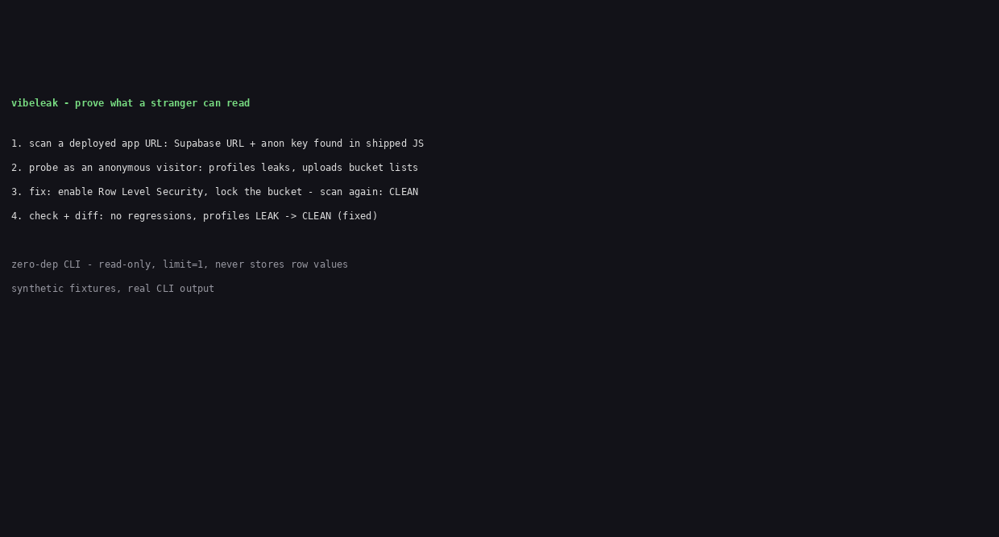

# vibeleak

**Prove what a stranger can read from an AI-built app - from only the deployed app URL.**

`vibeleak` fetches an app the way any visitor does, finds the Supabase project URL and anon key in the JavaScript the app already ships, then probes each table and storage bucket as an anonymous visitor. One command, one verdict: CLEAN, LEAK, or REVIEW - with a JSON report and a baseline diff so a closed table that opens again fails CI.

Zero runtime dependencies. TypeScript, Node 20+. Read-only: GET/HEAD only, `limit=1`, never stores row values.

## Why this exists

In November 2026, German security firm Crissy Field (Hamburg), working with the newspaper Handelsblatt, reported that AI-built apps were shipping with their databases readable by anyone. The figures, from the Crissy Field research report (November 2026; Handelsblatt article 2 November 2026):

- 159,041 Lovable projects identified in Common Crawl (apps created December 2025 - September 2026). Of those, 34,545 used Supabase as their backend.
- **24,664 websites sent database records to the browser as soon as the page loaded, without any login or interaction.**
- With further read-only requests using the same public key the app itself uses, the researchers found records containing email addresses in **10,560 tables across 7,403 sites (30%)**.
- Worst cases, each a separate app: one service provider exposed **more than 1,000 identity records** (passport numbers, expiry dates, nationalities); one lifestyle forum exposed **more than 200,000 private chat messages and 80,000 profiles**; one CRM-style app exposed **about 280,000 customer emails**.

Read the numbers honestly - the researchers are explicit about the limits, and so is this tool:

- **30% is NOT a confirmed leak rate** for all Lovable apps. The sample is not representative, some email addresses are public contact or test data, and records without an email address were not counted.
- The researchers **could not establish whether any exposed data was misused**.
- Record counts are a **floor, not a total**: only part of each dataset was retrieved.
- This was **not a hack of Lovable's systems**. The researchers used read-only requests with the same public key the app itself ships. The root cause is Row Level Security left off in the app's Supabase database, with the public anon key doing the rest.
- Lovable's position, as reported: an industry-wide problem, and customers are responsible for their own apps and data under the contract.

The same class of bug had already been disclosed eight months earlier as CVE-2025-48757 (March 2025, CVSS 9.3). Lovable added a Security Scanner and an AI Security Reviewer after that - and the exposure repeated at a larger scale. The lesson is not "run a scanner once". It is "prove, on every deploy, that an anonymous request returns zero rows".

That is what `vibeleak` does.

## 1. How it compares (checked 15 November 2026)

| Tool | Form | What it does well | What it cannot do (vibeleak's wedge) |
|---|---|---|---|
| **supabase-rls-check** (Python CLI, consent-gated) | CLI | `probe` with an anon key via PostgREST; `scan-env` finds service_role keys in code; `--fail-on` for CI; refuses service_role before requesting | Catalog checks need a manual round-trip: export `check.sql`, paste it into the SQL Editor, export a CSV, then analyse. `probe` needs the user to supply the project URL and anon key. No baseline diff for anonymous exposure in one command. |
| **rls-doctor** (Node CLI, `check`/`probe`/`shadow`/`prove`) | CLI | Behavioural probe: impersonates app roles in a rolled-back transaction and counts rows per identity; deep catalog analysis (policy OR-combine, WITH CHECK fallback, owner bypass) | Requires `DATABASE_URL` - a direct Postgres connection. Lovable/vibe-code users usually do not have one. No anon-key-only mode, no start from a deployed app URL, no frontend bundle scan. |
| **Lovable Security Scanner + AI Security Reviewer** | In-platform | Runs where the app was built | Lovable only. No CI run, no exported evidence, no use for Bolt/v0/other Supabase apps. Lovable's own docs say the scan does not guarantee complete security. |
| **Supabase Security Advisor** | Dashboard | Flags tables with RLS disabled | Dashboard only. No CLI/CI, and it reads the catalog - it never proves what an anonymous request actually returns. |

**Where rivals beat us (read this before trusting vibeleak alone):** supabase-rls-check reads the catalog, so it catches subtle policy bugs (policy OR-combine, owner bypass, SECURITY DEFINER) that an anonymous probe cannot see. rls-doctor proves cross-user reads (user A reading user B's row); vibeleak only proves anonymous reads. Both analyse views and functions; vibeleak does not. vibeleak is the **outermost layer** - prove what a stranger can read - and complements, not replaces, a catalog audit.

## 2. Quickstart (install from source)

The `vibeleak` package is not published to npm yet. Install from source:

```sh
git clone https://github.com/techdevfun/vibeleak.git
cd vibeleak
npm install
npm run build
node dist/cli.js --help
```

Or link the binary locally:

```sh
npm link
vibeleak --help
```

## 3. Demo



Real CLI output on the local synthetic fixtures (no real app, no real Supabase project). The demo scans a fake Lovable-style app, finds a leaking `profiles` table and a listable `uploads` bucket, then - after the fixture is "fixed" - re-scans to CLEAN and diffs the two reports. Full transcript: [demo/transcript.txt](demo/transcript.txt).

## 4. Commands

```
vibeleak scan <app-url> [--i-own-this-app] [--out report.json]
                       [--config vibeleak.json] [--fail-on high]
                       [--tables a b]
vibeleak probe --url <project-url> --anon-key <key> [--tables a b]
                       [--i-own-this-app] [--out report.json]
                       [--config vibeleak.json] [--fail-on high]
vibeleak check [--report report.json] [--baseline baseline.json]
                       [--fail-on high] [--config vibeleak.json]
vibeleak diff --baseline baseline.json [--report report.json]
vibeleak init [--dir .]
```

- `scan`: fetch the app URL (max 3 redirects, 10 s timeout), collect same-origin JavaScript (max 10 files, 2 MB each), extract the Supabase URL and anon key, then probe. If a `service_role` JWT or `sb_secret_` key is found in the shipped bundle, that is a CRITICAL finding and probing stops - an admin key in the frontend makes table probing meaningless.
- `probe`: same engine with an explicit project URL and anon key. Use it when the app has no public frontend or the key is already known.
- `check`: read a report (default `report.json`), compare it with a baseline and the `vibeleak.json` allowlist. Exit 0 CLEAN / 1 LEAK / 2 input error / 3 REVIEW. A table that was clean in the baseline and now leaks is a regression and fails.
- `diff`: compare the current report with a baseline: new leaks, regressions (closed then re-opened), and fixed tables, one line each (`profiles: LEAK -> CLEAN (fixed)`).
- `init`: write a sample `vibeleak.json` (project URL, `publicTables` allowlist, `failOn`) and an empty `vibeleak.baseline.json`. Never writes a key into a file - keys come from a flag or `VIBELEAK_ANON_KEY` and are never logged.

### Config file (`vibeleak.json`, version 1)

```json
{
  "version": 1,
  "projectUrl": "https://YOUR-PROJECT-REF.supabase.co",
  "publicTables": ["public_posts"],
  "publicBuckets": ["public-assets"],
  "failOn": "high",
  "maxTables": 50
}
```

`publicTables` is the allowlist: tables that are intentionally public by design. A table outside the allowlist that an anonymous GET can read is a LEAK.

### Verdict rules (evaluated in order)

| Rule | Condition | Severity | Verdict |
|---|---|---|---|
| V1 | `service_role` JWT or `sb_secret_` in shipped JavaScript | CRITICAL | DENY (exit 1, probe stops) |
| V2 | Table outside the allowlist, anonymous GET returns >= 1 row | HIGH | LEAK (exit 1) |
| V3 | Bucket outside the allowlist, anonymous object listing works | HIGH | LEAK (exit 1) |
| V4 | Allowlisted table exposes a sensitive-looking column name (`password`, `secret`, `ssn`, `passport`, `token`, `api_key` - name match only, values never read) | MEDIUM | REVIEW (exit 3 unless a HIGH exists) |
| V5 | Tables cannot be enumerated (OpenAPI disabled, no `--tables`) | LOW | REVIEW (exit 3) |
| V6 | Every non-allowlisted table returns 0 rows, no V1/V3 | - | CLEAN (exit 0) |

`--fail-on` sets the severity that fails CI (default `high`).

### Typical CI flow

```sh
vibeleak scan https://my-app.example.com --i-own-this-app --out report.json
vibeleak check --report report.json --baseline vibeleak.baseline.json --fail-on high
vibeleak diff --baseline vibeleak.baseline.json --report report.json
```

## 5. Consent and safety (hard rules, no exceptions)

- **Only scan apps you own or are authorised to test in writing.** `scan` and `probe` require `--i-own-this-app` (or `VIBELEAK_I_OWN_THIS_APP=1`). Without it the command exits 2 and sends no request.
- **Only anon keys.** The tool accepts an anon JWT (`role: "anon"`) or a `sb_publishable_` key. A `service_role` or `authenticated` JWT is refused before any request, and an `sb_secret_` key is never sent anywhere.
- **Read-only, always.** Only GET/HEAD. No POST/PUT/PATCH/DELETE, no `/rest/v1/rpc/*`, no writes of any kind. One HEAD + one GET per table (`?select=*&limit=1`), one request per bucket, at most 50 tables per run.
- **No row values, ever.** Reports store column names and a 0/1 rows-visible flag only. The fixture data in `examples/` is synthetic and labelled as such.
- **10 second timeout per request, one retry at most** for transient network errors. No aggressive scanning: the tool proves what one anonymous visitor can read, nothing more.

## 6. Honest limits

- A CLEAN verdict means **anonymous reads are clean**. It is not a full audit. It does not catch: cross-user reads (user A reading user B's row), subtle policy bugs, write paths (anonymous INSERT/UPDATE), `SECURITY DEFINER` views/functions, or RLS inside functions. For those, use a catalog audit tool (supabase-rls-check, rls-doctor) - see section 1.
- **Storage object listing is probed with GET** (`GET /storage/v1/object/list/<bucket>`), because the tool is read-only by design. Real Supabase object listing is a POST endpoint, so a GET probe can return 405 there; the bucket list itself (`GET /storage/v1/bucket`) always works. Treat a non-listable result as "not proven listable", not as "proven private".
- **Key extraction can miss.** Obfuscated bundles, keys in lazy-loaded chunks, or a disabled OpenAPI document all lead to REVIEW (exit 3), not a false CLEAN. Use `probe --tables` with an explicit key when extraction fails.
- **A public table is not automatically a leak.** Pricing pages and public posts are public by design - that is what the allowlist is for. But an allowlisted table with a sensitive-looking column name still triggers a REVIEW (V4).

## 7. Roadmap

- `--tables` discovery from the PostgREST OpenAPI `definitions` when `paths` is empty.
- Optional `--json` machine output for `check` and `diff`.
- A `--strict` mode that also fails on V4/V5 findings.
- Publish `vibeleak` to npm (pending an owner decision on the npm token).

## Development

```sh
npm install
npm run build      # tsc, strict
npm test           # unit + e2e against the local fake PostgREST fixture
npm run test:live  # live smoke: cited Crissy Field figures still live (soft-skips offline)
npm run lint       # eslint + prettier
node scripts/preflight.js  # Rule 7: ASCII-only, no internal names
```

Fixtures live in `examples/`: a fake Lovable-style app (`fake-app/`, synthetic anon JWT, no real key) and a fake PostgREST server (`fake-postgrest/`, binds 127.0.0.1 only, `FAKE_MODE=leaky|fixed`). No test or demo ever touches a real Supabase project.

## License

MIT. See [LICENSE](LICENSE).
